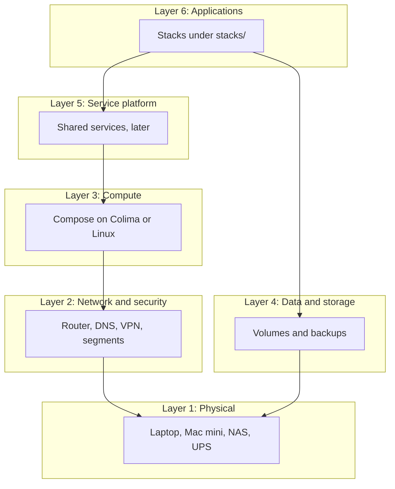
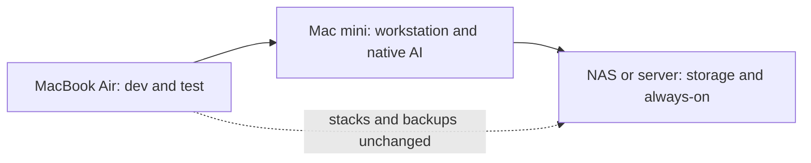

# Architecture

Version 1.0 · Last reviewed 2026-10-20

What the system is and why it is shaped this way. Rules are in [constraints](constraints.md), sequencing in the [roadmap](roadmap.md), decisions in the [register](project.md#decision-register).

## Context and goals

NexaHome is a small home platform for local AI, development tools, storage, networking and home automation. It runs on one 8 GB MacBook Air today. Other hardware is planned but not available, so every design must work on the laptop alone and move later without a rewrite. Availability is best effort.

Terms:
- **Layer:** one row of the layer table. **Host:** a physical machine running workloads. **Stack:** one deployable unit, a directory under `stacks/`.
- **Failure domain:** what stops working together when one thing fails. **Trust zone:** a network area whose members trust each other equally.
- **MQTT:** a lightweight publish/subscribe messaging protocol used by smart-home devices. **VLAN:** a separate virtual network on shared switches.

## Layers

Cross-cutting concerns (monitoring, configuration, documentation, security, backup) apply to every layer. Layers are logical, not separate machines.

| Layer | Domain | Current | Target |
| :--- | :--- | :--- | :--- |
| 1 | Physical | MacBook Air | Mac mini, NAS, UPS, upgraded switches |
| 2 | Network and security | Home router; ports bound to localhost only | DNS, VPN, segmentation |
| 3 | Compute platform | Colima VM with Docker Compose ([ADR 0004](adr/0004-colima-runtime.md)) | Docker Engine on a Linux host; local AI native on the Mac mini |
| 4 | Data and storage | Local volume; restore drill not yet built | NAS volumes, tested backups |
| 5 | Service platform | None | Shared services (auth, messaging) only when a stack needs them |
| 6 | Applications | `hello` demo stack | AI tools, home automation, media, personal apps |

## Hosts and failure domains

Containers on macOS run in a Linux VM and cannot use the GPU or USB devices. Local AI therefore runs natively on the host, not in containers.

| Host | Availability | Role | If it is down |
| :--- | :--- | :--- | :--- |
| MacBook Air M3 | Available | Development and test; sleeps; nothing depends on it | Development pauses; nothing else is affected |
| Mac mini | Planned | Workstation, development and native local AI; may sleep | Local AI and remote development pause; always-on services must not depend on it |
| NAS or dedicated server | Planned | Storage, backups, 24/7 services; whether these are one machine or two is not decided | Storage, backups and always-on services pause |
| Network gear | Planned | Segmentation, secure remote access | Remote access and isolated segments are lost; local use continues |
| UPS | Planned | Clean shutdown of server and NAS on power loss | Unclean shutdown risk only |

Rules: critical services never depend on monitoring ([observability](observability.md#decoupling-rule)) or on the Mac mini. A per-service dependency map is added when more than one real service exists.

## Network and trust zones

| Zone | Members | Status |
| :--- | :--- | :--- |
| Localhost | Containers on the laptop, ports bound to `127.0.0.1` | Current |
| LAN | Trusted devices at home | Planned |
| Management | VPN or SSH access for administration | Planned; method not decided |
| IoT segment | Smart-home and microcontroller devices on a separate VLAN, no access to the other zones | Planned |

Administrative interfaces are never exposed to the public internet. No firewall design exists yet.

## Data, backup and restore

- Persistent data lives outside the code tree. Compose reads the data root from `NEXAHOME_DATA_DIR` (laptop default `./data`, gitignored). Use named volumes for database-style data on macOS and bind mounts for configuration.
- Target: three copies of important data on two kinds of storage with one copy off-site (the "3-2-1" rule). Not reachable without a NAS and an off-site destination.
- A backup counts only after a tested restore. Until a NAS exists, restore drills use a local volume. The backup tool is not chosen ([register](project.md#decision-register)).

## Secrets and identity

- Secrets live in a gitignored `.env` per stack and in a password manager, never in Git, images or documents. Encrypted secrets in Git are considered only once there is more than one host.
- One administrator account per system. No single sign-on or identity provider until a second user or a service requires one.

## Remote access

SSH from the MacBook Air to the Mac mini is required, for administration and deployment, VS Code Remote-SSH, Claude Code on the mini, and file transfer and backups. The goal is decided; the method and VPN choice are not, and depend on hardware. Detail goes into a runbook written when the hardware exists ([roadmap](roadmap.md)).

## Agent guardrails

AI agents run with least privilege and need approval for destructive actions. See [agent guardrails](constraints.md#agent-guardrails).

## Migration paths

| Hop | What moves | What stays | Check before moving on |
| :--- | :--- | :--- | :--- |
| Laptop to Mac mini | Development workflow, local AI, remote access | Stacks (same Compose files) | SSH works, `make check` passes on the mini, a stack starts healthy |
| Mac mini to NAS or server | Always-on stacks, storage, backups | AI and development stay on the mini | Restore drill passes on the new storage; the mini can be off without breakage |

## Capabilities, hosts and phases

Phase names refer to the [roadmap](roadmap.md#phases).

| Capability | Runs on | Phase | Hardware needed |
| :--- | :--- | :--- | :--- |
| Development tools, Git workflows | Laptop, then Mac mini | P0, P4 | None / Mac mini |
| Persistence and backups | Laptop first, NAS later | P2, P5 | None / NAS |
| Health and uptime view | Any always-on host | P3 | None |
| Local AI | Mac mini, native | P4 | Mac mini; model size not decided |
| Storage, photos, media | NAS | P5 | NAS |
| Core network (DNS, VPN, remote access) | Always-on host and network gear | P6 | Server and network gear |
| Home automation | Linux host with USB and network access | P7 | Linux host and devices; scope not decided |
| Personal finance, dashboards | Any host | Not scheduled | None |

## Decisions

The decision register is in [project.md](project.md#decision-register); rationale is in [adr/](adr/).

Changelog: 1.0 (2026-10-20): rewritten; added failure domains, trust zones, backup and restore, identity, migration paths and a capability table; duplicated rules moved to constraints.
